<div align="center">


# polysh

### Stop translating commands in your head.

Type `ls -la` on Windows, `dir /s` on a Mac, or `Remove-Item -Recurse` anywhere,<br>
and polysh runs the right command for your OS, flags, pipes and all.

[](https://github.com/trentzx/polysh/actions/workflows/ci.yml)
[](https://github.com/trentzx/polysh/releases/latest)
[](LICENSE)




</div>

---

## The problem

You know this one:

```text
C:\> ls -la
'ls' is not recognized as an internal or external command,
operable program or batch file.
```

And the reverse:

```text
$ dir /s
dir: cannot access '/s': No such file or directory
```

If you use more than one OS (a Windows laptop and a Linux server, a Mac at work and a PC at home, or WSL next to PowerShell), you've typed the wrong dialect, sighed, and looked it up. **polysh fixes that.** Type what your fingers already know, and it runs the right thing.

## Install

**macOS / Linux**

```bash
curl -fsSL https://raw.githubusercontent.com/trentzx/polysh/main/install.sh | sh
```

**Windows** (PowerShell)

```powershell
irm https://raw.githubusercontent.com/trentzx/polysh/main/install.ps1 | iex
```

<details>
<summary>Other ways: Homebrew, Scoop, Cargo, or a manual download</summary>

```bash
brew install trentzx/polysh/polysh                     # Homebrew (macOS, Linux)
scoop install https://raw.githubusercontent.com/trentzx/polysh/main/packaging/scoop/polysh.json
cargo install --git https://github.com/trentzx/polysh  # from source, any OS
```

Or download a single file for your OS from [Releases](https://github.com/trentzx/polysh/releases/latest). Each one ships with a `.sha256` checksum.

</details>

## Quick start

```bash
polysh                        # start the interactive shell
polysh -c "rm -rf build"      # translate and run one command
polysh -n "kill -9 4242"      # explain only: show the translation, run nothing
```

`-n` doubles as a cheat sheet. Add `--to` to ask about any shell, from any OS:

```text
$ polysh -n --to powershell "grep -rin TODO src"
Get-ChildItem -Recurse -File src | Select-String -Pattern 'TODO'

$ polysh -n --to cmd "find . -name '*.log' | grep -i error > errors.txt"
dir /S /B *.log | findstr /I "error" > errors.txt
```

## What makes it different

- **It speaks three dialects.** Windows cmd, Linux/macOS sh, and PowerShell, in any direction. Abbreviated PowerShell parameters work too, like `Remove-Item -rec -fo`.
- **It translates flags, not just names.** PowerShell aliases `ls` to `Get-ChildItem`, then breaks on `ls -la`. polysh knows `-la` means "all files, long format".
- **Pipes, chains and redirection just work.** `ls | grep x`, `mkdir out && cp a out`, `cmd 2>/dev/null`: each piece is translated, and `/dev/null` ↔ `NUL` ↔ `$null`.
- **Environment variables follow you.** `$HOME` ↔ `%USERPROFILE%` ↔ `$HOME`, `$USER` ↔ `%USERNAME%` ↔ `$env:USERNAME`, and `~` works everywhere.
- **It never guesses.** If it sees a flag it doesn't fully understand (like `rm -i`), it runs your line unchanged rather than doing something you didn't ask for.
- **It shows its work.** Every translation is printed before it runs, so you pick up the other OS's commands just by using it.
- **It feels like a real shell.** History, ↑/↓, suggestions from your history (→ to accept), Tab completion for paths, `cd -`, and Ctrl+C cancels the running command instead of exiting polysh.
- **It's instant and offline.** No AI, no network, no account. One small binary.

## What it translates

| Task | Windows cmd | Linux / macOS | PowerShell |
|---|---|---|---|
| List files | `dir` `/A` `/S` `/B` `/W` | `ls` `-a` `-l` `-R` | `Get-ChildItem` `-Force` `-Recurse` `-Name` |
| Find files by name | `dir /s /b *.txt` | `find . -name '*.txt'` | `gci -Recurse -Filter *.txt` |
| Copy | `copy`, `xcopy /E` | `cp`, `cp -r` | `Copy-Item` `-Recurse` |
| Move / rename | `move` | `mv` | `Move-Item` |
| Delete | `del` `/F` `/Q` | `rm` `-r` `-f` | `Remove-Item` `-Recurse` `-Force` |
| Make folder | `mkdir` / `md` | `mkdir -p` | `New-Item -ItemType Directory` |
| Remove folder | `rmdir` / `rd` `/S` `/Q` | `rmdir`, `rm -r` | `Remove-Item -Recurse` |
| Create empty file | `type nul >> f` | `touch` | `New-Item f` |
| Show a file | `type` | `cat` | `Get-Content` |
| Print text | `echo %VAR%` | `echo $VAR` | `Write-Output $env:VAR` |
| Clear screen | `cls` | `clear` | `Clear-Host` |
| Environment | `set` | `env`, `printenv` | `Get-ChildItem Env:` |
| Network info | `ipconfig` `/all` | `ifconfig`, `ip addr` | `Get-NetIPConfiguration` |
| Ping | `ping -n 4`, `ping -t` | `ping -c 4`, `ping` | `Test-Connection -Count 4` |
| Wait | `timeout /t 5` | `sleep 5` | `Start-Sleep 5` |
| List processes | `tasklist` | `ps`, `ps aux` | `Get-Process` |
| Kill by PID | `taskkill /PID n` `/F` | `kill`, `kill -9` | `Stop-Process -Id n` `-Force` |
| Kill by name | `taskkill /IM name.exe` | `pkill`, `killall` | `Stop-Process -Name name` |
| Find a program | `where` | `which` | `Get-Command` |
| Search text | `findstr` `/I` `/S` `/N` | `grep` `-i` `-r` `-n` | `Select-String` |
| Change folder | `cd /d` | `cd`, `cd -`, `cd ~` | `Set-Location` |

Paths (`src\main` ↔ `src/main`), variables, null devices and chain operators (`;` ↔ `&`) are converted too.

**Missing a command you use every day?** [Request it](https://github.com/trentzx/polysh/issues/new?template=command_request.yml). Each one is a small, self-contained contribution.

## How it works

```text
 "rm -rf build && ls > files.txt"
       │
       ▼  split           at | && || ; &, keeping redirections with their command
 [rm -rf build]  &&  [ls]  > files.txt
       │
       ▼  parse           detect each command's dialect and read its flags
 POSIX · Remove { recursive, force, [build] }  &&  POSIX · ListDir { }
       │
       ▼  emit            write the same intents in your OS's dialect
 (if exist "build\*" (rmdir /S /Q "build") else (del /F /Q "build")) && dir /B > files.txt
       │
       ▼  run             cmd /C on Windows, sh -c everywhere else
```

The middle step is the key. Every command is reduced to an **intent** (what it means, not how it's spelled), so adding a dialect means teaching polysh to read and write intents, not writing N×N rules.

## How it compares

| | Knows every dialect | Translates flags | Pipes and chains | Offline and instant | Nothing new to learn |
|---|:-:|:-:|:-:|:-:|:-:|
| **polysh** | ✅ | ✅ | ✅ | ✅ | ✅ |
| PowerShell aliases | partly | ❌ | ✅ | ✅ | ✅ |
| WSL / Git Bash / Cygwin | ❌ Linux only | ❌ | ✅ | ✅ | ✅ |
| Nushell, Xonsh, Fish | ❌ own syntax | ❌ | ✅ | ✅ | ❌ |
| AI terminals | ✅ | ✅ | ✅ | ❌ | ✅ |

## Roadmap

- [x] Pipes, chains and redirection
- [x] PowerShell as a third dialect
- [x] History, suggestions, Tab completion and Ctrl+C handling
- [x] Environment variables (`%USERPROFILE%` ↔ `$HOME` ↔ `$env:…`)
- [x] One-line installers, Homebrew and Scoop
- [ ] Run inside PowerShell instead of cmd on Windows (`polysh --shell pwsh`)
- [ ] More commands: `tree`, `head`/`tail`, `chmod`/`icacls`, `shutdown`, `curl`/`Invoke-WebRequest`
- [ ] Your own rules in a config file
- [ ] `winget install polysh` and crates.io

## Contributing

polysh is built to be easy to extend: one command is usually about 30 lines and a couple of tests. See [CONTRIBUTING.md](CONTRIBUTING.md) to get started.

## Known limitations

- On Windows, commands run through `cmd`, so PowerShell commands are translated to cmd. Running them in PowerShell directly is on the roadmap.
- Command substitution (`$(…)`, backticks) is run as typed.
- `type` is treated as the Windows "print file" command, so the POSIX `type <cmd>` built-in isn't available through polysh.

## License

[MIT](LICENSE)

<div align="center">

**If polysh saved you a trip to Stack Overflow, a ⭐ helps other people find it.**

</div>
